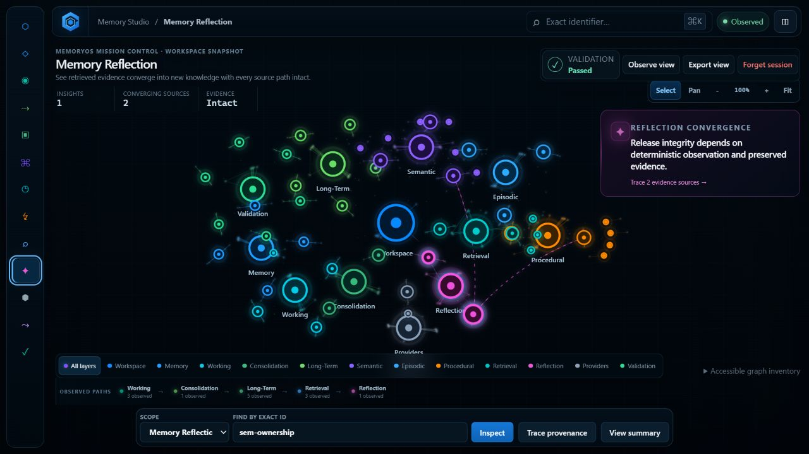

# MemoryOS 1.1 MO-1102 — Cognitive Trace

[MemoryOS 1.1 documentation index](README.md)

## Purpose

Sprint 2 adds the first production Cognitive Trace system to Memory Studio.
A Cognitive Trace is an immutable, deterministic account of the observed
journey from the Long-Term evidence snapshot owned by a derived knowledge
value, through the Reflection-owned Retrieval candidate, to a selected
Reflection.

This is an additive web-presentation capability. The frozen MemoryOS 1.0
runtime, CCA-STUDIO-1.0 C++ Contract, six Studio operations, and Sprint 1
semantic-world architecture are unchanged.

## Architecture

```text
accepted detached Studio observation
                |
                v
    immutable ObservationFrame
       |                  |
       v                  v
detached snapshot    SemanticWorld
       |                  |
       +--------+---------+
                v
       Cognitive Trace builder
       - exact typed references
       - owned evidence-snapshot checks
       - relationship integrity
       - deterministic branch order
                |
                v
       immutable CognitiveTrace
                |
                v
       Living Connectome renderer
       - consumes membership and order
       - performs no trace construction
```

`web/js/cognitive-trace.js` owns construction, exact queries, validation, and
canonical JSON serialization. It is independent of the DOM, camera, layout,
renderer, host adapter, clocks, randomness, and asynchronous activity.

`web/js/graph.js` accepts a completed trace beside the existing immutable
semantic world. It indexes only the supplied node and relationship references.
It never inspects MemoryOS values, walks the graph to infer a journey, parses
an explanation chain, or manufactures a missing stage.

## Trace model

Every `MemoryOSCognitiveTrace` is bound to one exact:

- Workspace identifier;
- Studio session identifier;
- observation-frame identifier and sequence; and
- typed semantic-world key for the selected Reflection.

The trace contains ordered source branches. Each step has only a sequence,
role, semantic-world node key, optional semantic-world relationship key, and
explicit traversal direction. Semantic payloads remain authoritative in the
bound observation frame and are not duplicated into the trace.

The fixed roles are:

1. `origin-evidence`
2. `semantic-transformation`
3. exactly one Reflection-owned `retrieval` step
4. `reflection-current`

Branch order is the frozen Reflection source order. Evidence order is the
source asset's stored `sourceEntries` order. Trace serialization preserves
those sequences exactly.

## Retrieval boundary

Every Reflection source is the detached `KnowledgeCandidate` snapshot owned by
that Reflection. It carries exactly one typed Semantic, Episodic, or Procedural
value and that value's ordered Long-Term evidence snapshots. The builder uses
this owned value directly; it never substitutes a similarly identified value
from the current knowledge aggregates and never resolves evidence against the
current Long-Term aggregate.

Explanation-chain tokens remain opaque and are never parsed into inferred
provenance. Because the frozen observation does not retain the originating
RetrievalSession identity, a candidate visible in a current RetrievalSession is
not claimed as the cause of a Reflection even when its fields happen to match.

The released reference observation therefore produces two real branches:

```text
ltm-002 -> sem-determinism -> owned candidate ------> Reflection

ltm-001 --+
           +-> proc-release-review -> owned candidate -> Reflection
ltm-002 --+
```

Each candidate-to-source world relationship is traversed in reverse for
journey presentation; its stored direction remains unchanged. Current
RetrievalSession candidates remain visible outside the trace but are not
promoted into a causal relationship that MemoryOS did not record.

## Validation and failure behavior

Construction is atomic. No partial trace is returned when any branch fails.
Validation rejects:

- Workspace, Studio-session, or frame mismatches;
- absent or non-Reflection targets;
- missing, malformed, or multiply typed owned source candidates;
- duplicate candidates with the same typed source identity;
- absent or malformed Long-Term evidence inside an owned source snapshot;
- impossible derived-session lifecycle, query, result, or source correspondence;
- disagreement between a ReflectionSession's own source list and its embedded
  Reflection result;
- missing or inconsistent semantic-world relationships;
- non-contiguous branch or step order;
- unknown node or relationship references; and
- mutable or only shallow-frozen trace values; and
- serialized data that differs from deterministic reconstruction.

Standalone and session-owned Reflections are independent even when they share
an identifier. Successful traces, query results, validation results, and
deserialized traces are deeply immutable. Canonical JSON round-trips
byte-for-byte against the same observation frame.

## Living Connectome behavior

Selecting an exact Reflection enters Trace mode. The validated trace becomes
the dominant visual structure while all other semantic-world nodes and
relationships remain visible, selectable, and keyboard accessible at reduced
emphasis.

Trace rendering is static. It adds no timers, shimmer, propagation animation,
polling, inferred activity, or synthetic cognition. Deterministic branch-step
markers and stroke weight supplement color. The existing Follow interaction
remains independent view state.

Selecting another member of the active trace preserves Trace mode. Selecting
outside it, clearing selection, changing route, forgetting the Studio session,
or losing the target in a later accepted observation exits Trace mode. A later
accepted frame rebuilds a new immutable trace only when the exact target still
exists and the complete journey remains valid.

## Before and after

### Before: Reflection as one perspective in the semantic world



### After: the observed journey becomes the interface

The Trace-mode capture must be taken from the running implementation after
selecting `reflection-release-integrity`. No synthetic, composited, or
pre-implementation image is included as release evidence.

The final running-product evidence is the repository-hosted
[MO-1108 Trace capture](screenshots/memory-studio-mo1108-trace.png).

The before and after states use the same deterministic reference observation,
Reflection route, semantic layout, camera, and filter. Entering Trace mode does
not alter MemoryOS state.

## Verification

The dependency-free web suite covers deterministic trace construction,
ordering, exact typed identity, owned Retrieval boundaries, evidence and relationship
integrity, atomic rejection, deep immutability, canonical serialization,
frame binding, replay readiness, and the renderer boundary.

The native Studio tests remain the authority for the frozen C++ Contract. No
native production file or public API is modified by Sprint 2.

## Historical technical debt at MO-1102 closure

The following items describe the state when MO-1102 closed. Cognitive Replay,
its explicit controls, and the integrated return path were subsequently
delivered by MO-1104 through MO-1108; this list is not the current release
status.

- The frozen detached observation does not expose the originating
  RetrievalSession identifier. Sprint 2 therefore models only the candidate
  snapshot the Reflection actually owns and makes no session-level causal
  claim.
- The session timeline retains every accepted observation frame in memory.
  Sprint 2 does not yet define a bounded retention policy, persisted archive,
  replay cursor, or Replay controls.
- Browser interaction behavior is verified against the dependency-free local
  presentation; a future cross-browser visual-regression lane should pin the
  trace-mode capture across supported engines.

## Historical Sprint 3 recommendation

This recommendation is retained as milestone history and was superseded by
the released Living Connectome, Cognitive Replay, and integrated workflow.

Add a bounded retention policy for the existing immutable observation-frame
timeline and a renderer-independent trace cursor. That foundation can enable
explicit Replay without adding a Time Machine, semantic Diff,
counterfactuals, or mutation. The next sprint should first specify retention
limits, frame addressing, and discontinuity behavior; only then should it add
playback controls.
